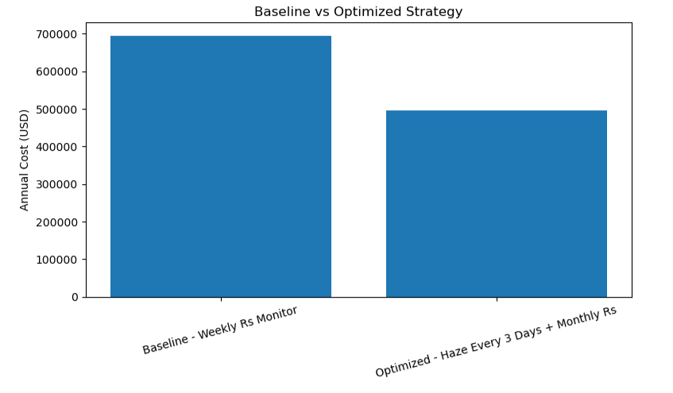
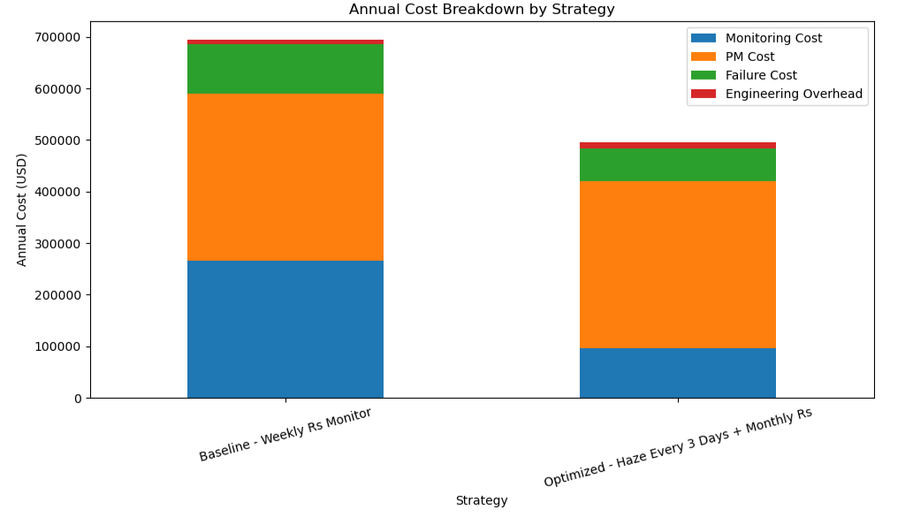

# RTA Module Maintenance Cost Optimizer


## Overview

This project is a data-driven cost optimization framework for Rapid Thermal Anneal (RTA) toolsets in semiconductor manufacturing.

The goal is to improve preventive maintenance decision-making by combining:

- high-frequency early warning signals
- low-frequency electrical verification
- failure risk estimation
- maintenance cost modeling

This project proposes a two-tier monitoring strategy to reduce dependence on expensive Rs monitor wafers while maintaining process health and early drift detection capability.

---

## Problem Statement
Traditional RTA monitoring often relies on high-cost Rs/SheetRho monitor wafers, which:
- require pre-treatment, ion implant, and dose verification
- are expensive to run frequently
- are better suited for final verification than early warning

As a result, the monitoring approach is costly and often reactive instead of proactive.

---

## Proposed Solution
This project redesigns the monitoring strategy into two layers:

### Tier 1: High-Frequency Monitoring
- Implant-based bare wafer
- Haze/cross-section haze measurement
- Every 3 days
- Used for early drift detection, stage alignment, and process trend monitoring

### Tier 2: Low-Frequency Verification
- Rs / SheetRho monitor wafer
- Every 2 weeks to monthly
- Used for long-term uniformity verification and model calibration

---

## Estimated Impact
- Reduce Rs monitor frequency by ~75%
- Save approximately ~$200K annually per RTA toolset
- Improve early drift detection
- Lower risk of late-stage excursions

---

## Project Structure
```text
data/raw/
data/processed/
notebooks/
src/rta_optimizer/
reports/figures/
```

---

## Key Results

- **~75% reduction** in Rs / SheetRho monitor wafer frequency
- **~$200K estimated annual cost savings** per RTA toolset
- **50% monitor cost reduction** through optimized verification strategy
- **15% scrap reduction potential** by improving early drift detection
---

### Annual Cost Comparison


---

### Annual Cost Breakdown


---

## How to Review This Project

__For a quick review:__
1. __Read:__ `reports/executive_summary.md`
2. __Review:__ `src/rta_optimizer/cost_model.py`
3. __Open:__ `notebooks/03_cost_optimization.ipynb`
4. __Check exported figures:__ `reports/figures/`

---

## Installation

```bash
pip install -r requirements.txt
```

---

## Dependencies

```text
This project uses:

Python == 3.11+
pandas == 2.2.3
numpy == 2.1.2
matplotlib == 3.9.2
scipy == 1.14.1
scikit-learn == 1.5.2
statsmodels == 0.14.4
pyDOE2 == 1.3.0
jupyter == 1.1.1
notebook== 7.2.2

```
